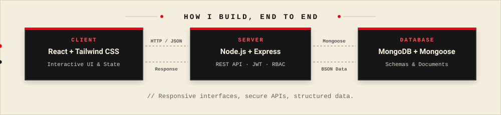

<!-- Palette: Forest #2F5D3A | Leaf #3E7B4F | Cream #F5F0E1 | Sand #D9D2BC | Ink #3B3B2F -->

<div align="center">




<a href="https://afsalt.in"></a>
<a href="https://github.com/mhdafsalt"></a>


</div>

<br>

## About

```js
const mohammedAfsal = {
  role: "Full-Stack Developer (MERN)",
  location: "Kerala, India",
  stack: ["React", "Node.js", "Express", "MongoDB", "Tailwind CSS"],
  focus: ["Responsive web apps", "Secure REST APIs", "JWT auth & RBAC"],
  openTo: "Entry-level developer roles",
  portfolio: "https://afsalt.in",
};
```

I like owning a feature from end to end: the interface a user touches, the API behind it and the data underneath. I build responsive web applications, and I'm looking for an entry-level role where I can ship real features and keep growing.

<br>

## How I Build

<div align="center">

</div>

<br>

## Technical Skills

<div align="center">

| | |
|:--|:--|
| **Frontend Development** |  |
| **Backend Development** |  |
| **Database** |   |
| **Tools & Platforms** |  |
| **Authentication & API Development** |    |

</div>

<br>

## Featured Projects

<!-- Replace REPO_NAME in each link with your repository name. Add live demo links in the text below each card. -->

<div align="center">

<a href="https://github.com/mhdafsalt/REPO_NAME"></a>

<a href="https://github.com/mhdafsalt/REPO_NAME"></a>

<a href="https://github.com/mhdafsalt/REPO_NAME"></a>

<a href="https://github.com/mhdafsalt/REPO_NAME"></a>

</div>

<br>

## Currently Learning

<!-- Replace with what you are actually learning, then delete this comment. -->

```js
const learning = [
  "[Add topic]",
  "[Add topic]",
  "[Add topic]",
];
```

<br>

## GitHub Statistics

<div align="center">


<!-- Optional: uncomment after the snake workflow has run once (see instructions).

-->

</div>

<br>

## Connect With Me

<div align="center">

<a href="https://afsalt.in"></a>
<a href="https://github.com/mhdafsalt"></a>

*Open to entry-level Full-Stack and MERN developer roles. Let's build something good.*


</div>
