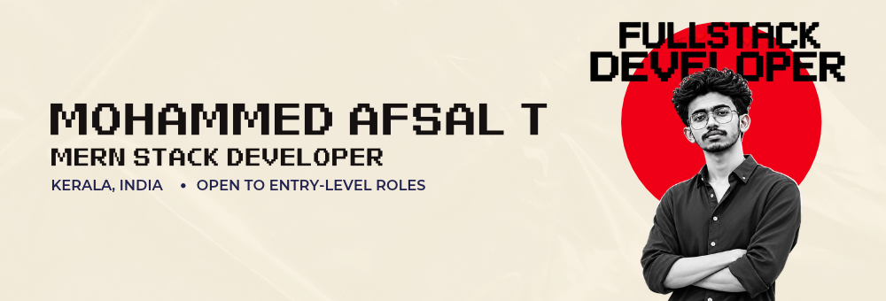
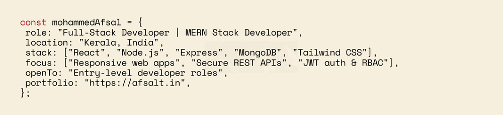

<!-- Palette: Crimson Red #F00016 | Dark Wine #B22731 | Cream #F4EEDF | Sand #D9D2BC | Ink #161111 -->

<div align="center">




<a href="https://afsalt.in"></a>
<a href="https://github.com/mhdafsalt"></a>
<a href="https://www.instagram.com/qubix.dzn"></a>


</div>

<br>

## About

<div align="center">

</div>

<br>

I like owning a feature from end to end: the interface a user touches, the API behind it and the data underneath. I build responsive web applications, and I'm looking for an entry-level role where I can ship real features and keep growing.

<br>

## How I Build

<div align="center">

</div>

<br>

## Technical Skills

<div align="center">

| | |
|:--|:--|
| **Frontend Development** |  |
| **Backend Development** |  |
| **Database** |   |
| **Tools &amp; Platforms** |  |
| **Authentication &amp; API Development** |    |

</div>

<br>

## Featured Projects

<!-- Replace REPO_NAME in each link with your repository name. -->

<div align="center">

<a href="https://github.com/mhdafsalt/REPO_NAME"></a>

<a href="https://github.com/mhdafsalt/REPO_NAME"></a>

<a href="https://github.com/mhdafsalt/REPO_NAME"></a>

<a href="https://github.com/mhdafsalt/REPO_NAME"></a>

</div>

<br>

## Currently Learning

```js
const learning = [
  "TypeScript",
  "Next.js",
  "Docker & Containerization",
];
```

<br>

## GitHub Statistics

<div align="center">


<br><br>


<br><br>


<!-- Optional: uncomment after the snake workflow has run once (see instructions).

-->

</div>

<br>

## Connect With Me

<div align="center">

<a href="https://afsalt.in"></a>
<a href="https://github.com/mhdafsalt"></a>
<a href="https://www.instagram.com/qubix.dzn"></a>

<br>

*Open to entry-level Full-Stack and MERN developer roles. Let's build something good.*


</div>
